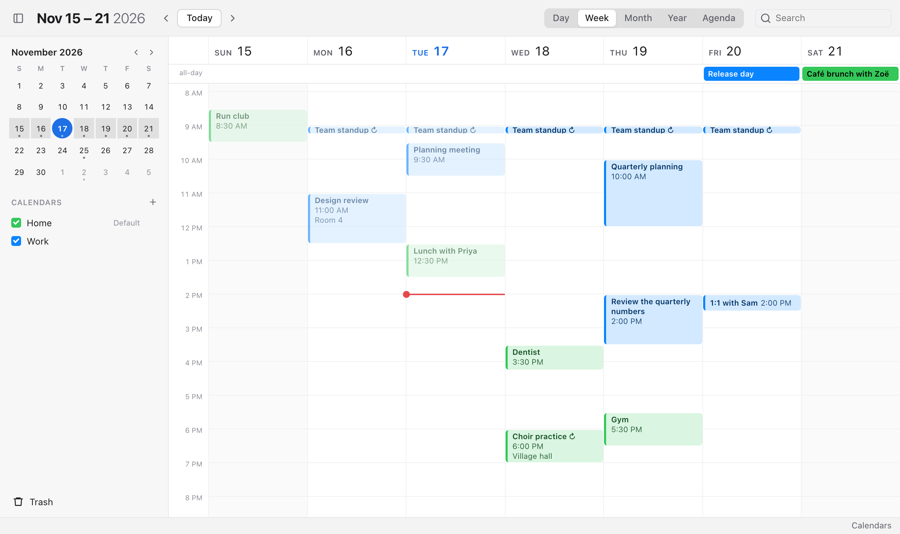

# Daybird

Daybird is a calendar that keeps each of your calendars in a plain `.ics` file, in a folder you choose. Run it as a desktop app, in a browser, on your NAS, or from the terminal, all on the same files.



- **Five views, all from the keyboard.** Day, Week, Month, Year and Agenda, each one key away. Drag on the grid or press **⌘N** to make an event, and **⌘K** runs any command.
- **Everything a calendar file can say.** Repeating events with every iCalendar rule, every time zone, reminders, search, a Trash and undo for every change.
- **Your files, not a database.** Standard iCalendar files that any other calendar app can read. Daybird never overwrites a change made elsewhere without asking.

## Getting started

Download the desktop app for macOS, Windows or Linux from the [releases](../../releases). On first start it asks where to keep your calendars, Documents/Daybird by default. Open an `.ics` file with Daybird to import it.

To run it from source you need Node 22.18 or later, pnpm and [just](https://github.com/casey/just):

```bash
just setup
just run-web
```

The [development guide](docs/development.md) covers the NAS server, its Docker image and the `daybird` command line.

## Documentation

- [Features](docs/features.md) and [Controls](docs/controls.md)
- [Development](docs/development.md) and [Architecture](docs/architecture.md)
- [Product requirements](docs/plans/prd.md)

## License

[MIT](LICENSE)
