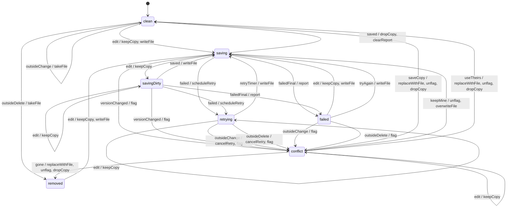

# Architecture

Daybird is one TypeScript code base with three hosts and a CLI. The browser, the NAS server's client and the Electron app run the same UI; only where the calendar files come from differs.

```
     ┌──────────────── apps/web (Preact + signals, one Vite build) ────────────────┐
     │  App · Toolbar · Sidebar (mini month) · RangeView · Dialogs · StatusBar       │
     │  AppController (settings, view, anchor date, dialogs, notices)               │
     │  commands.ts (the catalog) · shortcuts.ts · nativeMenu.ts                    │
     └─────────────────────────────────────┬────────────────────────────────────────┘
                                           │ imports
     ┌──────────────────── packages/ui (Preact + signals) ─────────────────────┐
     │  CommandCatalog (keys, two-key sequences, recents) · listenForKeys        │
     │  Dialog · ListPopup · PopupMenu · focusTrap · Icon · settings · schedule  │
     └─────────────────────────────────────┬───────────────────────────────────┘
                                           │
     ┌──────────────────── packages/core (pure TS) ────────────────────┐
     │  plainDate (calendar dates) · views (ranges, grids, titles)      │◄──── apps/cli
     │  colours (palette, accents, text on a colour)                    │
     └──────────────────────────────────────────────────────────────────┘
     ┌──────────── packages/node-files (Node) ────────────┐
     │  FolderStore (versions, lock files, inside only)   │◄──── apps/desktop, later apps/server and apps/cli
     │  writeAtomic · withLockFile                        │
     └────────────────────────────────────────────────────┘
```

## Layering

- `packages/core` has no DOM and no Node APIs. ESLint rejects `window`, `document`, `localStorage` and `process` there, so the engine runs the same in a browser, the CLI and the tests.
- `packages/ui` knows the DOM but not where files live.
- `packages/node-files` is the only code that touches the disk. Its `FolderStore` is one calendar folder: paths are folder-relative and can't leave it, a write is atomic (a temporary file renamed over the target) and, when conditional, checks the version while holding a `.<name>.lock` file, so the desktop app, the NAS server and the CLI can share a folder. `folderResult` turns its errors into plain data for IPC.
- The desktop app's page reaches the folder through `NativeStore` in `packages/ui`, which sends each call over the preload bridge to `apps/desktop/src/folders.ts` in the main process, where `FolderStore` runs it. The page only ever names files in the folder the user chose.
- Other packages import only through `@daybird/<package>`, and tests only through their own package's `src/index.ts`; the architecture test rejects deep imports.
- `test/architecture.test.ts` also keeps platform APIs in one place each: key listeners in `packages/ui/src/commands/`, timers in `packages/ui/src/schedule.ts`, browser storage in `packages/ui/src/settings.ts`, and effect hooks in the dialog and popup components.

## Core (`packages/core`)

- `plainDate.ts`: calendar dates as `YYYY-MM-DD` strings, with arithmetic on whole days so a daylight-saving change can't move a date (PRD §4.1).
- `layout/`: where events sit (PRD §6.1, §6.2). `timeGrid.ts` cuts timed occurrences into one segment per day in wall-clock minutes of the display zone and splits each day into columns; `dayBars.ts` stacks bars that span days into rows, for the all-day strip and the month weeks; `monthWeek.ts` lays out a Month week: bars, one-line entries in the free lanes and "N more" where a day overflows; `dayCounts.ts` counts events per day for the mini month's dots and the Year view's tints (`busyLevel`); `agenda.ts` groups occurrences by the days they touch for the Agenda list.
- `views.ts`: what each view shows: its date range, the month grid, stepping, and the title (PRD §6).
- `colours.ts`: the calendar palette and accent colours, and the text colour that reads on each (PRD §5.6).
- `ical/`: our own iCalendar reader and writer (PRD §3.2, §3.3). `contentLine.ts` parses and formats one line, folds at 75 octets and handles text escapes. `document.ts` reads a file into an immutable tree of components and properties in file order. Each node read from disk keeps its physical lines, so an unedited file writes back byte for byte; a changed node is written fresh. Lines it can't read are kept and written back as they were; a file whose structure is broken is refused with a line number. `calendarFile.ts` reads the name and colour, fills in missing UIDs and stamps PRODID. The fixture corpus is in `packages/core/test/fixtures/ical/`. `values.ts` reads and writes DATE, DATE-TIME, DURATION and PERIOD values; `vtimezone.ts` reads a VTIMEZONE into a zone and writes one for an IANA zone from the offsets `Intl` reports across a year.
- `time/`: wall-clock times and zones (PRD §4.3, §4.4). `dateTime.ts` holds `PlainDateTime` and local seconds, the wall clock counted as if it were UTC. `zones.ts` gives offsets for IANA zones from `Intl` (a table of transitions per zone and year, found by probing and bisecting) and for a file's own VTIMEZONE rules; it turns wall-clock times into instants, moving a time in a spring-forward gap forward and taking the earlier of a repeated time. `windowsZones.ts` is the CLDR Windows-to-IANA table. `rrule.ts` parses, writes and expands RRULEs on the wall clock with the 50,000 cap; `recurrenceSet.ts` adds RDATEs and takes away EXDATEs and EXRULEs; `ruleWords.ts` describes a rule in English.
- `model/`: calendars and edits (PRD §4.1, §4.2, §7, §8.2). A `Calendar` keeps its whole parsed file; `calendar.ts` groups its VEVENTs into series by UID. `event.ts` reads a VEVENT into fields and writes patches back in place. `occurrences.ts` expands series for a range; an occurrence is named by its key, its original start in wall-clock seconds in the master's frame. `seriesEdits.ts` makes This/Future/All changes on one series; `workspace.ts` applies them across calendars, stamps edited events and adds VTIMEZONEs. `trash.ts` reads and writes `.daybird/trash.ics`, `undo.ts` records which files a change touched, and `invariants.ts` checks the §4.2 rules after every random operation in tests.

## UI (`packages/ui`)

- `commands/`: the `CommandCatalog`. Shortcuts are parsed once; `forEvent` turns a key press into a command, a wait for the second key of a sequence, or nothing (PRD §12). `listenForKeys` is the one key listener.
- `settings.ts`: the per-device settings and where they are kept (PRD §13).
- `components/`: `Dialog` (modal, focus trap, Esc), `ListPopup`, `PopupMenu` (right-click and ⋯ menus built from catalog commands) and the `Icon` set.
- `platform/`: where the folder lives (PRD §3.7). `CalendarStore` is the one interface the app reads and writes files through, with folder-relative paths and a SHA-256 version per file; a conditional write refuses with `ConflictError` when the file changed or went. `MemoryStore` is for tests and as the last fallback, `BrowserStore` wraps a browser folder handle (the private folder, or one the user picked) and holds a Web Lock per file while it checks and writes. `localSnapshots.ts` keeps recovery snapshots in local storage, one per window, with a Web Lock that tells a live window's snapshot from a closed one's. The contract test in `packages/ui/test/storeContract.test.ts` runs every store through the same cases.
- `folder/`: the open folder. `FolderSession` holds the workspace and the undo stack as signals and runs one save chart per file (below). `sessionTypes.ts` has its types and constants, `sessionFiles.ts` the pure helpers that read and write one file, `snapshots.ts` the snapshot format, and `folderSettings.ts` the folder's own settings in `.daybird/settings.json` (the default calendar).

## Saving

Each file (each calendar, and the trash) has its own copy of the save chart in `packages/ui/src/folder/saveChart.ts` (PRD §3.4–§3.6). `FolderSession` fires an event, the chart says which state comes next and which effects to run, and the session runs them. `saveChart.test.ts` drives the chart with random events against a model of the disk and checks its promises: never two writes at once, nothing written over a conflict until the user chooses, and unsaved changes always in the recovery snapshot. `folderSessionRandom.test.ts` does the same with the real session, a `MemoryStore` that fails writes on demand, and changes made elsewhere; at the end the disk holds exactly what the window shows.



- `writeFile` sends the version last read or written; `overwriteFile` (Keep Mine) sends none. A new file is written with `create`, so it never replaces one that appeared meanwhile.
- `keepCopy` marks the file for the next recovery snapshot; `dropCopy` unmarks it once the disk has every change.
- `takeFile` takes a file changed elsewhere as one undo step; a file that went removes its calendar. `replaceWithFile` does the same after the user chose Use Theirs or Save Mine as a Copy.
- `flag` opens the conflict dialog, `unflag` closes it. `report` and `clearReport` show and clear "Couldn’t save <calendar>." in the status bar.
- `refresh` reads only files in `clean`, `retrying` or `failed`, and skips a file whose own write landed during the read.

## Web shell (`apps/web`)

- `AppController` holds the app's state in signals: the settings, today's date, the anchor date the view shows, the open dialog and the status-bar notice. Components read it and call its methods; they keep no state of their own beyond small things such as which month the mini month shows.
- `main.tsx` wires the controller to the page: the theme and accent on `<html>`, the key listener, a 30-second tick that notices midnight, and, in the desktop app, the native bridge.
- `eventActions.ts` is everything creating, editing and deleting an event does; the popover, the drags in `dragCreate.ts` and the commands call it. A visit to the popover is one undo group: the session joins steps of one group, and `retract` drops the group's step with no redo, for Escape on an untouched new event.
- In core, `eventTimes.ts` turns drags and the popover's fields into start and end values, and `details.ts` gives the popover an occurrence in its own frame with its repeat in words.
- `moveActions.ts` moves, copies and pastes events; `dragMove.ts` turns a drag on any event into a target under the pointer (a `.db-column[data-date]` for a time, a `[data-week]` row for a day) and draws the ghost there; `eventCommands.ts` holds the commands on the selected event, before Previous and Next so the arrow keys move a selected event. In core, `eventMoves.ts` works out the new times and writes one event as a calendar file for the clipboard.

## Desktop (`apps/desktop`)

The Electron main process, a sandboxed preload with context isolation, and the `daybirdNative` bridge. The native menu bar is built from the command catalog and sent over IPC. `DAYBIRD_HEADLESS=1` runs it with no window or Dock icon, for automated checks.
